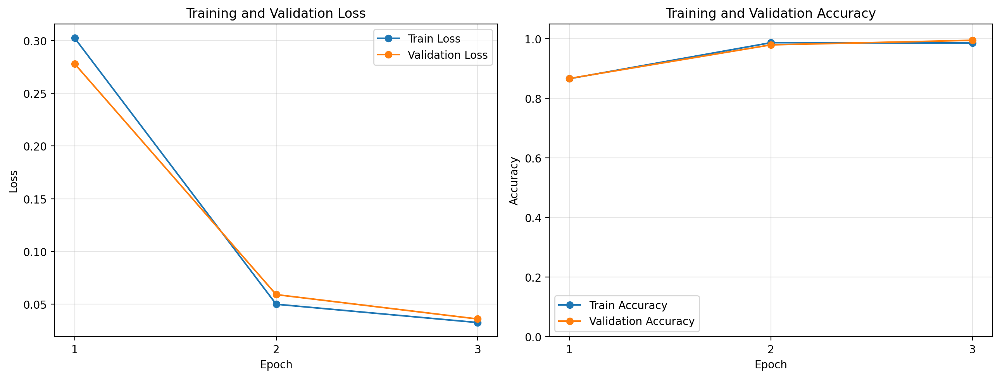
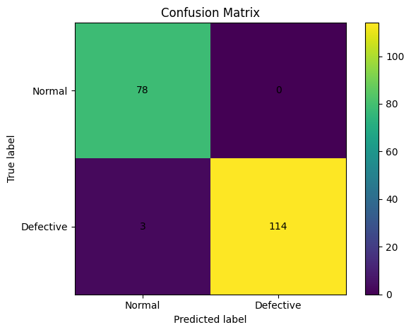

# Spark AI Visual Defect Detection

Computer Vision Engineer technical assessment solution for classifying manufacturing product images as either **Normal** or **Defective**.

The project covers the complete workflow expected for a small production-oriented computer vision system: dataset analysis, transfer-learning-based model training, validation and test evaluation, false-positive/false-negative analysis, image inference through FastAPI, automated API tests, and Dockerized CPU deployment.

> **Dataset note:** The assessment stated that a small Normal/Defective dataset would be provided, but it was not received within the submission window. To avoid blocking the assessment, I used a public industrial casting-defect dataset as a clearly documented fallback while preserving the same binary classification problem. The public dataset is not redistributed in this repository.

## 1. Problem

The goal is to classify production-line product images into two classes:

- **Normal**
- **Defective**

In a manufacturing setting, the most important operational error is typically a **false negative**: a defective product predicted as Normal and therefore potentially allowed to pass inspection.

## 2. Final Approach

The final model is **ResNet18 pretrained on ImageNet**, with its final fully connected layer replaced for two-class classification.

ResNet18 was selected because it is:

- lightweight and fast to train
- well suited to transfer learning on small image datasets
- straightforward to debug and maintain
- efficient enough for CPU inference
- a strong production baseline before considering larger or more complex architectures

The full pretrained network was fine-tuned rather than training only the classification head.

## 3. Project Structure

```text
.
├── api/
│   ├── __init__.py
│   └── main.py
├── data/
│   ├── .gitkeep
│   └── README.md
├── docs/
│   └── architecture.md
├── models/
│   └── .gitkeep
├── outputs/
│   ├── error_analysis/
│   │   ├── false_negatives/
│   │   └── false_positives/
│   ├── metrics/
│   └── plots/
├── src/
│   ├── __init__.py
│   ├── audit_dataset.py
│   ├── config.py
│   ├── dataset.py
│   ├── evaluate.py
│   ├── model.py
│   ├── predict.py
│   ├── run_evaluation.py
│   ├── run_training.py
│   ├── train.py
│   ├── transforms.py
│   └── utils.py
├── tests/
│   └── test_api.py
├── Dockerfile
├── requirements.txt
├── requirements-api.txt
└── README.md
```

## 4. Dataset

### Fallback dataset

Because the assessment dataset was not received before the submission deadline, the solution was completed using the public **Casting Product Image Data for Quality Inspection** dataset.

Dataset source:

- Kaggle — **Casting Product Image Data for Quality Inspection**
- https://www.kaggle.com/datasets/ravirajsinh45/real-life-industrial-dataset-of-casting-product

For this assessment I used the original `casting_512x512` images rather than the dataset's pre-augmented train/test folders so that splitting and augmentation remained under the control of this project.

Class mapping:

```text
ok_front  -> 0 -> Normal
def_front -> 1 -> Defective
```

## Demo and Trained Model

The final demo video and trained ResNet18 checkpoint are available in the
[v1.0.0 GitHub Release](https://github.com/abdullah763/spark-ai-visual-defect-detection/releases/tag/v1.0.0).

### Dataset audit

| Property | Result |
|---|---:|
| Total images | 1,300 |
| Normal | 519 (39.92%) |
| Defective | 781 (60.08%) |
| Image format | JPEG |
| Image size | 512 × 512 |
| Color mode | RGB |
| Corrupt images | 0 |
| Exact duplicate groups | 0 |

Visual inspection showed that many defects are located around the **outer rim/edge** of the casting, including chipped, broken, rough, or irregular edges. Some defects are much smaller and more subtle.

The class ratio is approximately 1.5:1. This is a moderate imbalance rather than an extreme one, so I used a **stratified split** and monitored class-specific precision/recall rather than introducing class weights without evidence that they were needed.

### Data split

A deterministic stratified split with `random_seed=42` was used:

| Split | Images | Percentage |
|---|---:|---:|
| Train | 910 | 70% |
| Validation | 195 | 15% |
| Test | 195 | 15% |

The final test set contained:

- 78 Normal images
- 117 Defective images

The test set was not used for gradient updates or checkpoint selection.

## 5. Preprocessing and Augmentation

Evaluation preprocessing:

- convert image to RGB
- resize to `224 × 224`
- convert to tensor
- normalize using ImageNet mean and standard deviation

Training augmentation was deliberately conservative:

- small random rotations
- mild brightness variation
- mild contrast variation

Aggressive cropping was avoided because many defects occur on the product's outer edge and cropping could remove the actual defect signal.

## 6. Training Configuration

Final configuration:

| Setting | Value |
|---|---|
| Architecture | ResNet18 |
| Initialization | ImageNet pretrained |
| Input resolution | 224 × 224 |
| Output classes | 2 |
| Fine-tuning | Full network |
| Loss | CrossEntropyLoss |
| Optimizer | AdamW |
| Learning rate | `1e-4` |
| Batch size | 32 |
| Epochs | 3 |
| Random seed | 42 |
| Model selection | Lowest validation loss |
| Training device | NVIDIA Tesla T4 (Kaggle) |

The model converged quickly, so additional epochs were not added simply to chase a higher score.

### Training history

| Epoch | Train Loss | Train Accuracy | Validation Loss | Validation Accuracy |
|---:|---:|---:|---:|---:|
| 1 | 0.3024 | 86.59% | 0.2780 | 86.67% |
| 2 | 0.0499 | 98.68% | 0.0591 | 97.95% |
| 3 | 0.0326 | 98.57% | 0.0359 | 99.49% |

Training and validation loss both decreased substantially and there was no obvious train/validation divergence during the three-epoch run.

### Training curves



## 7. Final Test Results

The best validation-loss checkpoint was evaluated on the held-out 195-image test set.

For the metrics below, **Defective is treated as the positive class**.

| Metric | Result |
|---|---:|
| Accuracy | **98.46%** |
| Precision | **100.00%** |
| Recall | **97.44%** |
| F1-score | **98.70%** |
| False positives | **0** |
| False negatives | **3** |

Confusion matrix:

```text
                 Predicted
                 Normal  Defective
Actual Normal       78       0
Actual Defective     3     114
```

Equivalent matrix representation:

```text
[[78, 0],
 [ 3, 114]]
```

### Confusion matrix



## 8. Error Analysis

The final model produced **0 false positives** and **3 false negatives**.

The three false-negative test cases were:

| Image | Prediction | Confidence | Observation |
|---|---|---:|---|
| `cast_def_0_3855.jpeg` | Normal | 0.539 | Borderline prediction with a weak/subtle defect signal. |
| `cast_def_0_571.jpeg` | Normal | 0.997 | Visually close to Normal and therefore a difficult subtle-defect case. |
| `cast_def_0_6959.jpeg` | Normal | 0.696 | Small localized defect near the outer rim. |

The observed failure pattern suggests that **small localized edge defects and subtle defect morphology** are the main remaining challenges.

One likely contributor is global downsampling from `512 × 512` to `224 × 224`, which can reduce the prominence of very small edge defects.

The confidence values also show two different failure modes:

- some errors are near the decision boundary, such as confidence `0.539`
- one visually subtle case is a high-confidence mistake (`0.997`)

No decision-threshold tuning was performed on the test set.

The evaluation pipeline automatically saves:

```text
outputs/metrics/test_metrics.json
outputs/metrics/error_analysis.csv
outputs/plots/confusion_matrix.png
outputs/error_analysis/false_positives/
outputs/error_analysis/false_negatives/
```

## 9. Reproducing Training

The raw dataset is intentionally not committed to Git.

Prepare two class directories:

```text
/path/to/ok_front
/path/to/def_front
```

Then run:

```bash
python -m src.run_training \
  --normal-dir "/path/to/ok_front" \
  --defective-dir "/path/to/def_front" \
  --epochs 3 \
  --batch-size 32 \
  --learning-rate 0.0001 \
  --num-workers 2
```

The best validation-loss checkpoint is saved to:

```text
models/best_model.pth
```

Training history is saved to:

```text
outputs/metrics/training_history.csv
```

## 10. Reproducing Evaluation

After training:

```bash
python -m src.run_evaluation \
  --normal-dir "/path/to/ok_front" \
  --defective-dir "/path/to/def_front" \
  --checkpoint "models/best_model.pth" \
  --batch-size 32 \
  --num-workers 2
```

This recreates the same deterministic train/validation/test split and evaluates only the test partition.

## 11. Inference API

The FastAPI application loads the trained checkpoint once during startup.

### Health endpoint

```text
GET /health
```

Healthy example:

```json
{
  "status": "healthy",
  "model_loaded": true,
  "device": "cpu"
}
```

If the checkpoint is unavailable, the API starts in a degraded state rather than crashing.

### Prediction endpoint

```text
POST /predict
```

Supported upload types:

- JPEG
- PNG
- WEBP
- maximum upload size: 10 MB

Example request:

```bash
curl -X POST \
  -F "file=@example.jpeg" \
  http://127.0.0.1:8000/predict
```

Example response:

```json
{
  "predicted_class": "Defective",
  "confidence": 0.93
}
```

The API includes:

- file-type validation
- empty-file validation
- image decoding validation
- upload-size validation
- model availability handling
- structured response validation
- inference logging
- inference latency logging
- error handling

Softmax confidence is returned for convenience, but it should not be interpreted as a calibrated probability without a separate calibration study.

## 12. Local Setup

Tested locally with Python 3.11.

Create and activate a virtual environment:

```bash
python3.11 -m venv .venv
source .venv/bin/activate
```

Install dependencies:

```bash
python -m pip install -r requirements.txt
```

Place a trained checkpoint at:

```text
models/best_model.pth
```

Run the API:

```bash
uvicorn api.main:app --host 127.0.0.1 --port 8000
```

Swagger documentation:

```text
http://127.0.0.1:8000/docs
```

## 13. Automated Tests

Run:

```bash
python -m pytest -v
```

Final local result:

```text
6 passed
```

The tests cover:

- health endpoint behavior
- missing-model handling
- unsupported file formats
- empty uploads
- invalid/corrupt image data
- valid prediction response structure

A non-blocking Starlette/httpx deprecation warning may appear with the current dependency versions.

## 14. Docker Deployment

The Docker image uses **CPU-only PyTorch** for a smaller and more portable inference environment. Training dependencies are kept separate from inference-only dependencies.

Before building the inference image, either reproduce training or place the trained checkpoint at:

```text
models/best_model.pth
```

The Docker build copies this checkpoint into the image.

Build:

```bash
docker build -t spark-defect-api:final .
```

Run:

```bash
docker run --rm \
  --name spark-defect-final \
  -p 8000:8000 \
  spark-defect-api:final
```

Verify:

```bash
curl http://127.0.0.1:8000/health
```

Final Docker smoke test:

```text
status       = healthy
model_loaded = true
device       = cpu
```

One measured prediction request in the local Docker CPU container logged **74.83 ms** model-inference latency. This is a smoke-test measurement on the development machine, not a full production latency benchmark or p95/p99 measurement.

## 15. Architecture

The system architecture is documented in:

[docs/architecture.md](docs/architecture.md)

At a high level:

```text
Training
Dataset -> Audit -> Stratified Split -> Augmentation -> ResNet18
        -> Validation -> Best Checkpoint -> Held-out Test Evaluation

Inference
Image -> FastAPI Validation -> Preprocessing -> ResNet18
      -> Softmax -> Class + Confidence -> JSON Response

Deployment
Docker -> FastAPI/Uvicorn -> PyTorch CPU Inference
```

## 16. Model Checkpoint

The trained checkpoint is expected at:

```text
models/best_model.pth
```

The binary checkpoint is not required to be stored in Git for reproducibility because the complete training command and dataset mapping are documented above. If the checkpoint is supplied separately with the assessment submission, place it at the path above before starting the API or building the Docker image.

## 17. Known Limitations

- The official assessment dataset was not received, so a public industrial casting dataset was used as a transparent fallback.
- The dataset is visually consistent and may be easier than a real multi-line manufacturing environment.
- Exact SHA-256 duplicate checking found no byte-identical duplicates, but perceptual near-duplicate detection was not performed.
- Product/batch identifiers were not available for group-aware splitting.
- Resizing from 512 × 512 to 224 × 224 can reduce visibility of small edge defects.
- The three final errors were false negatives, so missed defects remain the key risk.
- Softmax confidence is not calibrated.
- The current deployment benchmark is a local single-request smoke test rather than a production load test.
- Full GPU determinism was not enforced, so small run-to-run differences can occur even with a fixed data-split seed.

## 18. Future Improvements

Improvements should be driven by observed failure modes rather than model complexity alone. Practical next steps include:

1. Test a higher input resolution such as 320 or 384 pixels for small edge defects.
2. Explore edge/ROI-aware preprocessing while preserving the full product context.
3. Collect more examples of subtle rim defects and difficult Normal/Defective boundary cases.
4. Evaluate perceptual near-duplicate detection and group-aware splitting if product/batch IDs become available.
5. Calibrate model confidence on a dedicated validation set.
6. Tune the Defective decision threshold on validation data if manufacturing requirements prioritize recall over false-positive cost.
7. Add production latency/load testing with p50/p95/p99 measurements.
8. Add monitoring for input drift, confidence drift, error rate, and model/version metadata in a deployed system.

## 19. Summary

This solution demonstrates a complete, intentionally simple defect-classification workflow:

- audited and documented the dataset
- used a stratified 70/15/15 split
- fine-tuned an ImageNet-pretrained ResNet18
- achieved **98.46% test accuracy** and **98.70% F1-score**
- analyzed all false-positive/false-negative outcomes
- implemented a validated FastAPI inference service
- verified **6/6 automated API tests**
- packaged inference with CPU-only Docker
- verified Docker inference with **74.83 ms** observed single-request latency

The focus is on a solution that is reproducible, explainable, easy to debug, and realistic to maintain rather than unnecessarily complex.
