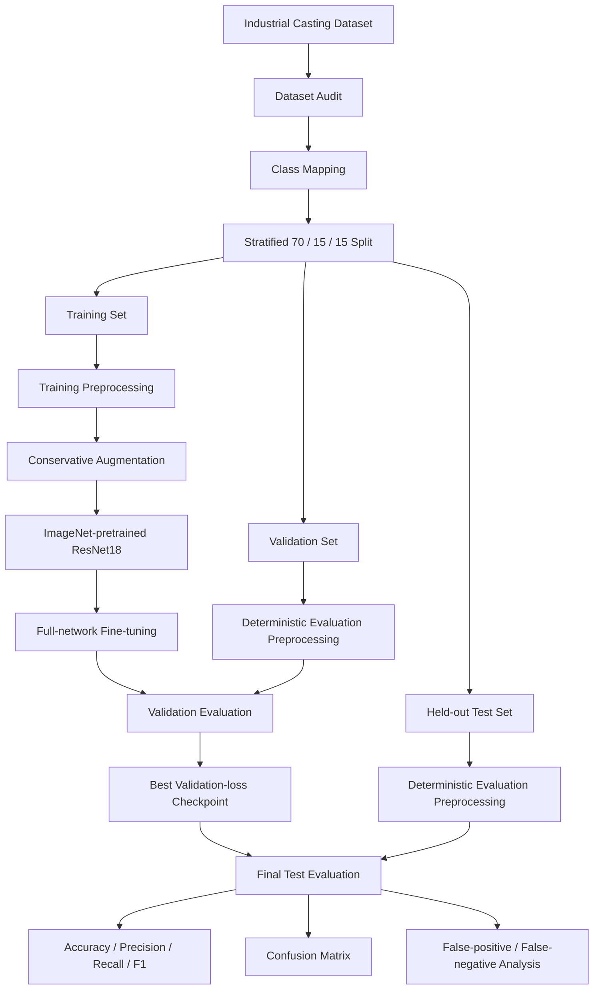
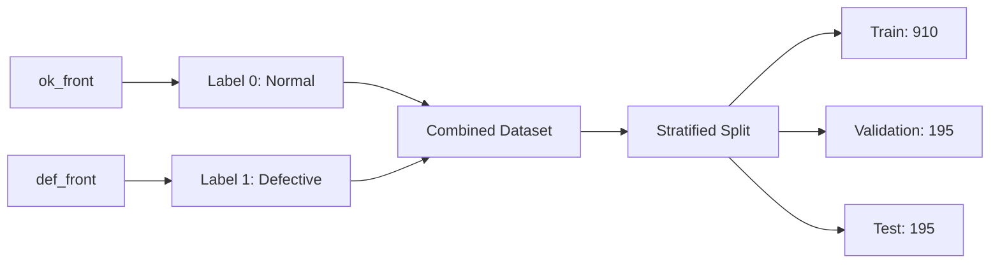
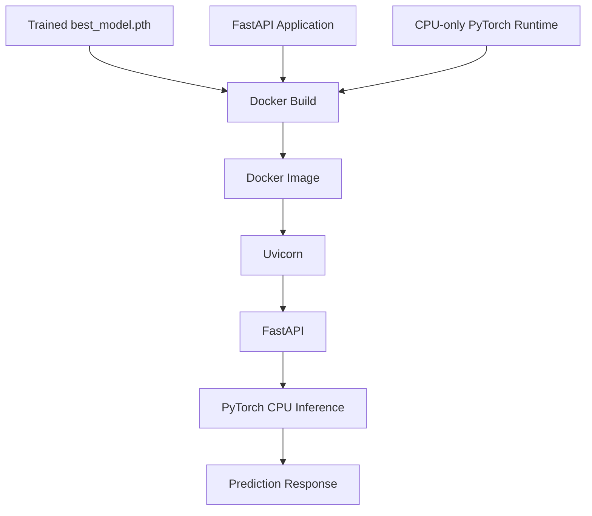
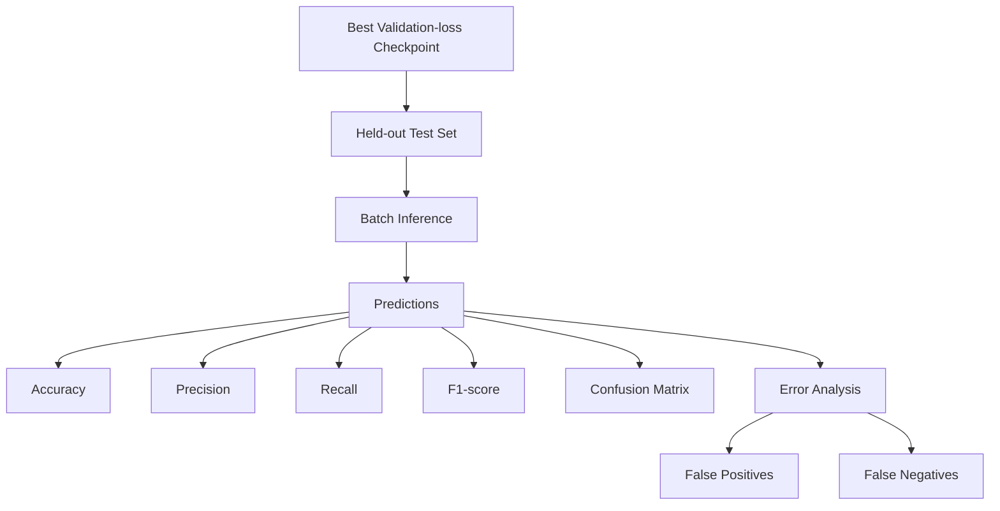
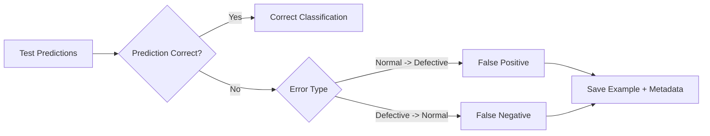

# System Architecture

This document describes the final architecture used for the Spark AI visual
defect detection assessment.

The solution performs binary image classification:

- `Normal`
- `Defective`

The final implementation uses an ImageNet-pretrained ResNet18, FastAPI for
inference, and a CPU-only Docker image for portable deployment.

---

## 1. Training Pipeline



### Training details

The final configuration is:

- Architecture: ResNet18
- Initialization: ImageNet pretrained weights
- Input resolution: `224 × 224`
- Output classes: 2
- Fine-tuning: full network
- Loss: CrossEntropyLoss
- Optimizer: AdamW
- Learning rate: `1e-4`
- Batch size: 32
- Epochs: 3
- Random seed: 42
- Model selection: lowest validation loss

The training data uses conservative augmentation:

- small random rotations
- mild brightness variation
- mild contrast variation

Aggressive cropping is avoided because many defects occur around the outer
rim of the product and cropping could remove the defect itself.

Validation and test images use deterministic preprocessing only.

---

## 2. Dataset Flow



Dataset summary:

- Total images: 1,300
- Normal: 519
- Defective: 781
- Image size: `512 × 512`
- Format: JPEG
- Color mode: RGB
- Corrupt images: 0
- Exact duplicate groups: 0

The class distribution is moderately imbalanced rather than severely
imbalanced, so class weighting was not introduced. A stratified split and
class-specific metrics were used instead.

---

## 3. Inference Pipeline


The API performs:

- model availability checks
- file-type validation
- empty-file validation
- upload-size validation
- image decoding validation
- preprocessing
- model inference
- response validation
- inference logging
- latency logging
- error handling

The trained checkpoint is loaded once during application startup.

---

## 4. API Endpoints

### Health

```text
GET /health
```

Healthy response example:

```json
{
  "status": "healthy",
  "model_loaded": true,
  "device": "cpu"
}
```

If the model checkpoint is missing, the API starts in a degraded state rather
than crashing.

### Prediction

```text
POST /predict
```

Input:

- JPEG
- PNG
- WEBP
- maximum upload size: 10 MB

Example response:

```json
{
  "predicted_class": "Defective",
  "confidence": 0.93
}
```

---

## 5. Deployment Architecture



The Docker image uses CPU-only PyTorch to reduce deployment size and improve
portability.

Training and development dependencies are kept separate from inference-only
dependencies.

The final local Docker smoke test verified:

- model loaded successfully
- `/health` returned `200`
- `/predict` returned `200`
- inference device: CPU
- observed single-request inference latency: `74.83 ms`

This latency value is a development-machine smoke-test measurement and should
not be interpreted as a production p95 or p99 benchmark.

---

## 6. Evaluation Pipeline



Final test results:

| Metric | Result |
|---|---:|
| Accuracy | 98.46% |
| Precision | 100.00% |
| Recall | 97.44% |
| F1-score | 98.70% |
| False positives | 0 |
| False negatives | 3 |

Confusion matrix:

```text
[[78, 0],
 [ 3, 114]]
```

For these metrics, `Defective` is treated as the positive class.

The most important operational failure mode is a false negative because it
represents a defective product incorrectly classified as Normal.

---

## 7. Error-analysis Flow



The final run produced three false negatives and zero false positives.

Observed failure patterns included:

- small localized outer-edge defects
- subtle defect morphology
- borderline confidence cases
- one high-confidence subtle-defect error

A likely contributing factor is the reduction from `512 × 512` to
`224 × 224`, which can reduce the visibility of very small defects.

---

## 8. Design Decisions

### Why ResNet18?

ResNet18 provides a practical balance between:

- accuracy
- training speed
- inference speed
- model size
- maintainability
- ease of debugging

For a small industrial image dataset, transfer learning with a lightweight
CNN is a stronger baseline than introducing a more complex architecture
without evidence that additional complexity is required.

### Why no class weights?

The dataset contains approximately 60% Defective and 40% Normal images.

This imbalance is moderate, and both classes contain enough samples for
training. Instead of introducing weighting automatically, the project uses:

- stratified splitting
- class-specific precision and recall
- confusion-matrix analysis
- false-positive / false-negative review

### Why CPU Docker inference?

The inference service is lightweight enough to run on CPU.

Using CPU-only PyTorch:

- improves portability
- avoids CUDA runtime dependencies
- reduces container size
- simplifies deployment

GPU deployment can still be considered if future throughput or latency
requirements justify it.

---

## 9. Future Architecture Improvements

Potential improvements should be driven by observed failure modes.

Useful next steps include:

1. Test higher input resolutions such as 320 or 384 pixels.
2. Explore edge-aware or ROI-aware preprocessing.
3. Collect more subtle rim-defect examples.
4. Add perceptual near-duplicate detection.
5. Use group-aware splitting if product or batch identifiers become available.
6. Calibrate model confidence.
7. Tune the Defective decision threshold on validation data if recall becomes
   the primary production objective.
8. Add production load testing with p50/p95/p99 latency measurements.
9. Add monitoring for input drift, confidence drift, prediction distribution,
   model version, and inference errors.
