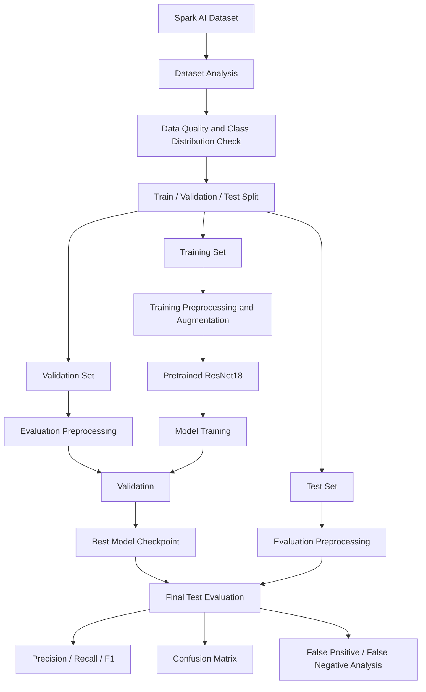
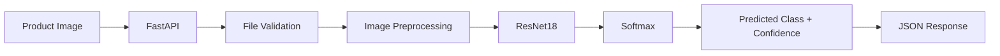
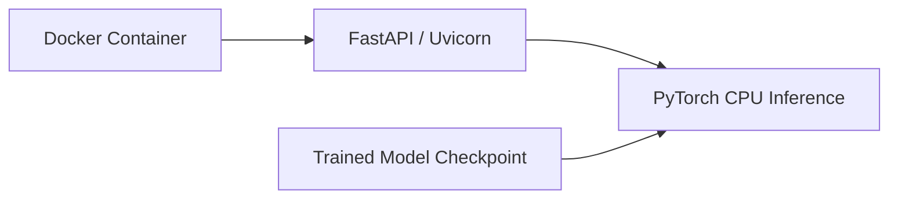

# System Architecture

## Training Pipeline

## Inference Pipeline

## Deployment

## Notes

- Training images may use augmentation after dataset inspection.
- Validation and test images use deterministic preprocessing only.
- The validation set is used for model selection.
- The test set is reserved for final evaluation.
- Class-imbalance handling will be decided after inspecting the provided dataset.
